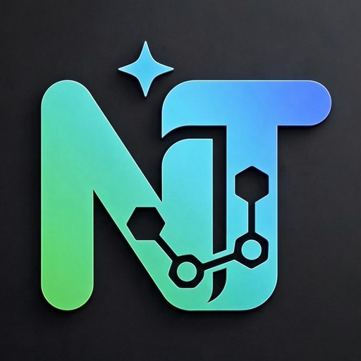
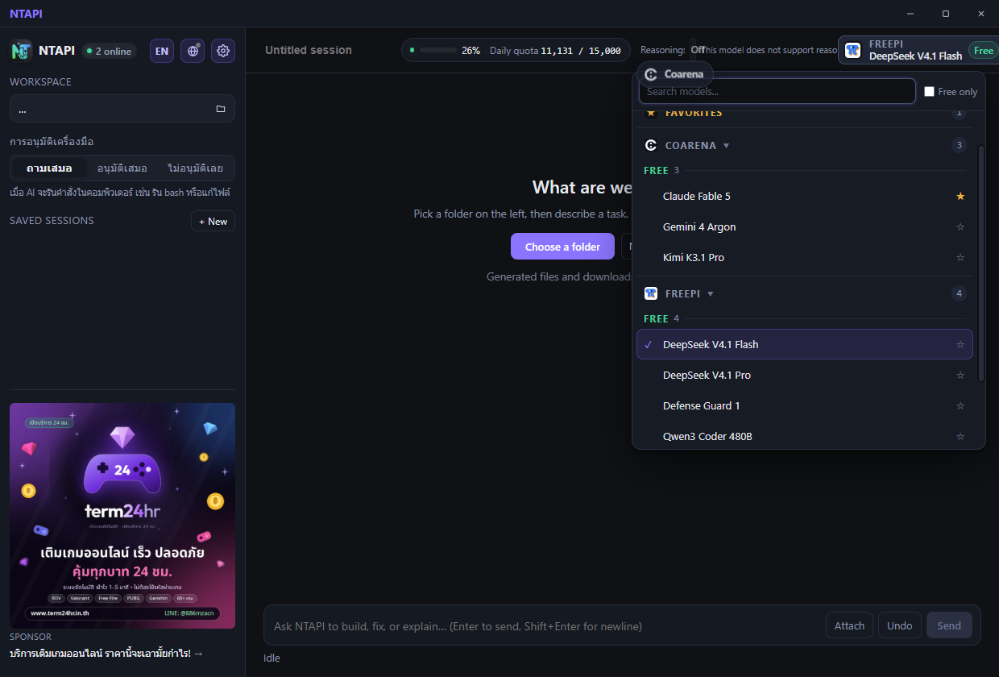

[](https://github.com/Cheumklang/NTAPI-releases/releases/latest)

# NTAPI

**โปรแกรมเดสก์ท็อปสำหรับใช้ AI หลายค่ายในหน้าต่างเดียว — ฟรี ไม่มีค่าสมัคร**

สร้างโดยคนไทย เพื่อการเรียนรู้และแบ่งปัน 🤝

[](https://github.com/Cheumklang/NTAPI-releases/releases/latest)
[](https://github.com/Cheumklang/NTAPI-releases/releases)
[](#-ดาวน์โหลดและติดตั้ง)
[](#-ผู้จัดทำ)

[⬇️ **ดาวน์โหลดเวอร์ชันล่าสุด**](https://github.com/Cheumklang/NTAPI-releases/releases/latest) · [🐞 แจ้งบั๊ก](mailto:cheumklang@gmail.com) · [🔐 ความเป็นส่วนตัว](PRIVACY.md) · [📄 ข้อกำหนดการใช้งาน](TERMS.md)



---

## ✨ NTAPI คืออะไร

โปรแกรมเดสก์ท็อปที่รวม **AI หลายบริษัท** ไว้ในที่เดียว ใช้ **คีย์ API ของคุณเอง**
โดยแต่ละค่ายมีโควตาฟรีรายวัน/รายสัปดาห์ให้ใช้ตามเงื่อนไขของเขา

หลายค่ายให้ใช้ผ่าน Terminal หรือ API ดิบ ซึ่งมือใหม่มักติดตรงนี้ NTAPI เปลี่ยนให้เป็น
หน้าจอแบบโปรแกรมทั่วไป — เลือกโมเดล กดส่ง ดูว่า AI กำลังคิดและทำอะไรทีละขั้น

> NTAPI ไม่ได้ขาย บริการ ไม่ได้ขายต่อโควตา และไม่ได้เก็บส่วนต่างจากค่า Token
> ถ้าคุณพอใจค่ายไหนก็เติมเงินกับค่ายนั้นได้โดยตรง โปรแกรมยังใช้คีย์เดิมต่อได้

## 🚀 จุดเด่น

|  | ฟีเจอร์ | รายละเอียด |
| --- | --- | --- |
| 🧩 | **หลายค่ายในหน้าต่างเดียว** | สลับผู้ให้บริการ/โมเดลได้ทันที กรองเฉพาะโมเดลฟรีได้ |
| 💬 | **แชทแล้วลงมือทำจริง** | อ่าน/เขียนไฟล์ในโปรเจกต์ ค้นหา รันคำสั่ง และเล่าให้ดูทีละขั้น |
| 🗂️ | **แยกเซสชันตามโปรเจกต์** | ประวัติแชทแยกตามโฟลเดอร์งาน ค้นหาและสลับได้ |
| 🌐 | **สองภาษา** | หน้าจอไทย/อังกฤษ สลับได้ทันที |
| 🔔 | **แจ้งเตือนเมื่อเสร็จ** | เสียงและ toast มุมขวาล่าง ไม่รบกวนขณะใช้งาน |
| ⬆️ | **อัปเดตอัตโนมัติ** | ตรวจ/ดาวน์โหลด/ติดตั้งได้จากในโปรแกรม |

## 🔌 ผู้ให้บริการที่รองรับ

| บริการ | เว็บไซต์ |
| --- | --- |
| Coarena | https://coarena.ai |
| FreePi | https://freepi.ai |
| Zro (moonmath.ai) | https://zro.moonmath.ai |
| NVIDIA build | https://build.nvidia.com |
| Token Harbor | https://tokenharbor.ai |
| LLM7.io | https://llm7.io |

**NTAPI ไม่มีส่วนเกี่ยวข้อง ไม่ได้เป็นตัวแทน และไม่ได้รับการรับรองจากบริษัทเหล่านี้**
ชื่อและโลโก้ใช้เพียงเพื่อบอกว่าโปรแกรมเชื่อมต่อกับบริการใดได้
บริการเหล่านี้อาจเปลี่ยนเงื่อนไข ลดโควตาฟรี หรือปิดให้บริการได้ทุกเมื่อ
โปรดปฏิบัติตามข้อกำหนดการใช้งานของแต่ละบริษัท รวมถึง **ไม่สร้างหลายบัญชีเพื่อ
หลีกเลี่ยงโควตาฟรี** เพราะอาจทำให้บัญชีของคุณถูกระงับถาวร

## 📥 ดาวน์โหลดและติดตั้ง

1. ไปที่แท็บ **[Releases](https://github.com/Cheumklang/NTAPI-releases/releases)** แล้วเลือกเวอร์ชันล่าสุด
2. ดาวน์โหลดไฟล์ **`NTAPI-Setup-x.y.z.exe`** (Windows 10/11 64-bit)
3. เปิดไฟล์ที่ดาวน์โหลด แล้วทำตามขั้นตอนติดตั้ง
4. เปิดโปรแกรม → **ตั้งค่า** → เลือกผู้ให้บริการ → ใส่ API key ของคุณ

> [!WARNING]
> ไฟล์ติดตั้งยังไม่ได้ลงชื่อดิจิทัล (code signing) Windows อาจขึ้นหน้าต่าง SmartScreen
> ให้กด **More info → Run anyway**
> ดาวน์โหลดจาก `github.com/Cheumklang/NTAPI-releases` เท่านั้น และเทียบค่า **SHA256**
> ที่ระบุอยู่ในหน้า Release ก่อนติดตั้ง (รุ่นใหม่ ๆ จะพิมพ์ SHA256 ไว้ท้ายหน้าดาวน์โหลด)

### ตรวจสอบไฟล์ก่อนติดตั้ง (ไม่บังคับ แต่แนะนำ)

เปิด PowerShell แล้วรัน:

```powershell
Get-FileHash .\NTAPI-Setup-x.y.z.exe -Algorithm SHA256
```

นำค่าที่ได้ไปเทียบกับ SHA256 ในหน้า Release รุ่นนั้น ถ้าไม่ตรง **อย่าติดตั้ง**

## 💡 ทำไมถึงสร้างโปรแกรมนี้

ผมสร้าง NTAPI เพื่อ **การศึกษา** และอยากแบ่งปันให้คนที่งบน้อยได้มีโอกาสลองใช้
และศึกษาการทำงานของ AI — ทั้งคนที่อยากทำโปรแกรม ทำวิดีโอ ทำเกม หรือแค่อยากรู้ว่า
AI ทำงานอย่างไร

เครื่องมือดี ๆ หลายตัวมีค่าใช้จ่ายรายเดือนที่สูงสำหรับหลายคน ผมจึงอยากให้มีทางเลือก
หนึ่งที่คนทั่วไปเข้าถึงได้ ลองใช้จริง ลองผิดลองถูก และเรียนรู้ไปพร้อมกัน

ถ้าโปรแกรมนี้มีประโยชน์กับคุณ ผมดีใจมาก 🙏

## 🧠 ข้อมูลของคุณอยู่ที่ไหน

- **ประวัติแชท การตั้งค่า และคีย์ API อยู่ในเครื่องคุณเท่านั้น** (`C:\NTAPI`)
- คีย์ API ถูกเข้ารหัสด้วย Windows DPAPI — โปรแกรมแสดงเพียง 4 ตัวท้าย
- **ไม่มีการส่งเนื้อหาแชทกลับมาที่ผู้พัฒนา** ไม่มี analytics ไม่มี SDK โฆษณา
- คำขอของคุณส่งตรงไปยังบริษัท AI ที่คุณเลือก ด้วยคีย์ของคุณเอง
- สิ่งเดียวที่ส่งออกอัตโนมัติคือ "รหัสสุ่ม" เพื่อนับจำนวนคนออนไลน์ (ดูรายละเอียดใน [PRIVACY.md](PRIVACY.md))

**ลบข้อมูลทั้งหมด:** ถอนการติดตั้ง → ลบโฟลเดอร์ `C:\NTAPI` และ `%APPDATA%\NTAPI`

## ❓ คำถามที่พบบ่อย

**ต้องมี API key ไหม?**
ต้องมีครับ — ขอฟรีได้จากเว็บของผู้ให้บริการแต่ละราย (บางรายให้ใช้โดยไม่ต้องใส่บัตร)
โปรแกรมไม่แถมคีย์และไม่แชร์คีย์ให้ใคร

**ฟรีจริงไหม ตรงไหนมีเงิน?**
ตัวโปรแกรมฟรีครับ รายได้มีจากพื้นที่ผู้สนับสนุน (มีป้ายกำกับชัดเจน) และ QR บริจาค
โดยสมัครใจ — ไม่มีการขายข้อมูล ไม่มีการขายต่อโควตา

**ทำไม AI ตอบช้า / ใช้ไม่ได้บางช่วง?**
โควตาฟรีของแต่ละค่ายจำกัดและอาจเต็ม บางบริการล่มหรือเปลี่ยนเงื่อนไขได้ตลอด
ลองสลับโมเดลหรือรอรอบโควตาถัดไป

**ใช้กับงานจริงได้ไหม?**
ได้ แต่ AI ยังตอบผิดได้ ควรตรวจสอบโค้ดและข้อมูลทุกครั้งก่อนนำไปใช้ และสำรองข้อมูลไว้

**มีเวอร์ชัน macOS / Linux ไหม?**
ยังไม่มีครับ ตอนนี้รองรับ Windows 10/11 (64-bit) เท่านั้น

**เจอบั๊ก / อยากให้เพิ่มค่ายไหน?**
ส่งอีเมลมาที่ cheumklang@gmail.com ครับ ทุกข้อความผมอ่านเอง

## 🔐 ความปลอดภัย

พบช่องโหว่ กรุณาอย่าเปิด Issue สาธารณะ — ส่งอีเมลหัวข้อ `[SECURITY]` มาที่
cheumklang@gmail.com ดูขอบเขตและข้อจำกัดที่ทราบแล้วใน [SECURITY.md](SECURITY.md)

## ☕ สนับสนุน

ในโปรแกรมมี QR สนับสนุนค่ากาแฟอยู่ที่ **ตั้งค่า → เกี่ยวกับ** — ไม่บังคับเลยครับ
แค่คุณได้ลองใช้และได้เรียนรู้อะไรจากมัน ก็เป็นกำลังใจให้ผมมากแล้ว ❤️

## 👨‍💻 ผู้จัดทำ

|  |  |
| --- | --- |
| 🪪 **ชื่อ** | ชนาธิป เชื่อมกลาง (Chanathip Cheumklang) |
| 🐣 **ชื่อเล่น** | นนท์ (Nont) |
| 📧 **อีเมล** | [cheumklang@gmail.com](mailto:cheumklang@gmail.com) |

## 📦 เกี่ยวกับ repo นี้

repo นี้เก็บ **ไฟล์ติดตั้งที่ build แล้ว** สำหรับระบบอัปเดตอัตโนมัติของโปรแกรม

- 🔒 โค้ดต้นฉบับอยู่ที่ repo ส่วนตัว `Cheumklang/NTAPI`
- 📁 repo นี้เก็บเฉพาะ `NTAPI-Setup-*.exe`, `.blockmap`, `latest.yml` และเอกสารสิทธิ์
- 🔄 โปรแกรมอ่าน `latest.yml` เพื่อตรวจหาอัปเดตและติดตั้งให้เอง

**ลิขสิทธิ์:** โปรแกรมเป็นลิขสิทธิ์ของผู้พัฒนา (all rights reserved) — ดู [LICENSE](LICENSE)
· การใช้งานอยู่ภายใต้ [TERMS.md](TERMS.md) · [PRIVACY.md](PRIVACY.md)

---

## 🇬🇧 English

**NTAPI** is a free Windows desktop app that puts several AI providers in one
window. You bring **your own API key** for each provider (many offer a free
daily/weekly quota); NTAPI turns the raw API/terminal workflow into a normal
desktop UI for beginners.

It also acts as an agent: it reads project files, writes code, runs commands and
shows each step. UI is Thai/English; updates install from inside the app.

**Install:** open [Releases](https://github.com/Cheumklang/NTAPI-releases/releases),
download `NTAPI-Setup-x.y.z.exe` (Windows 10/11 64-bit), run it, then go to
**Settings** to add a provider key.

> [!WARNING]
> The installer is unsigned, so Windows SmartScreen may ask you to confirm —
> choose **More info → Run anyway**. Download only from this repository and
> compare the SHA256 listed on the release page.

**Privacy:** chat history, settings and API keys stay on your machine
(`C:\NTAPI`, keys encrypted with Windows DPAPI). The only automatic outbound
call is an anonymous per-launch id used to count online users. No analytics, no
ad SDKs. See [PRIVACY.md](PRIVACY.md) and [TERMS.md](TERMS.md).

**Not affiliated** with, endorsed by, or sponsored by any AI provider.

**Created by** Chanathip Cheumklang (Nont) — cheumklang@gmail.com.

---

**ทำด้วยความตั้งใจ เพื่อให้ทุกคนได้เข้าถึง AI 🇹🇭**
